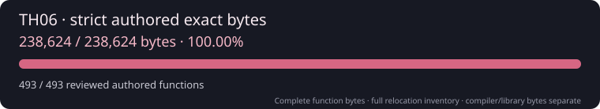

# 東方紅魔郷 ～ the Embodiment of Scarlet Devil

  

Source reconstruction of the original Japanese TH06 1.02h executable.
The goal is **98% authored exact bytes**, accepted through complete,
reproducible function comparisons with independently resolved relocations.

| Target property | Required value |
| --- | --- |
| Version | Original Japanese 1.02h |
| Size | 512,000 bytes |
| SHA-256 | `9f76483c46256804792399296619c1274363c31cd8f1775fafb55106fb852245` |
| MD5 | `fa3d64768b1bfc50703dedc2db92f7fa` |
| Image base | `0x00400000` |
| Entry point | `0x0045D746` |

Provide your own original executable at `resources/th06.exe`, then run
`python3 scripts/verify-target.py`. Executables, assets, toolchains, generated
code and analysis databases are private and excluded from this repository.

The project follows [th095](https://github.com/N0zoM1z0/th095)'s hash-attested
Ghidra, two-oracle acceptance, manifest replay and progress workflow. TH06
uses pinned **VC7.0 13.00.9466**. Every tool runs headless, with serialized
compiler work and bounded analysis resources.

Current setup and evidence: [handoff](docs/RE_HANDOFF.md),
[oracle policy](docs/ORACLES.md), [workflow](docs/RE_WORKFLOW.md),
[Ghidra](docs/GHIDRA.md). Reference exactness and maintained authored progress
are separate; a build or structural match does not earn exact credit.

## Credits

[GensokyoClub/th06](https://github.com/GensokyoClub/th06) provides the source
reference, names, mapping and VC7.0 build profile. The reference is pinned in
`config/reference.toml`; reused helpers retain their
[CC0 license](docs/LICENSE-GensokyoClub.txt). Their work is measured against
this project's original target and strict oracle before acceptance.

Touhou and its original game code/assets are by ZUN / Team Shanghai Alice.
This repository distributes reconstruction work and tooling only.
